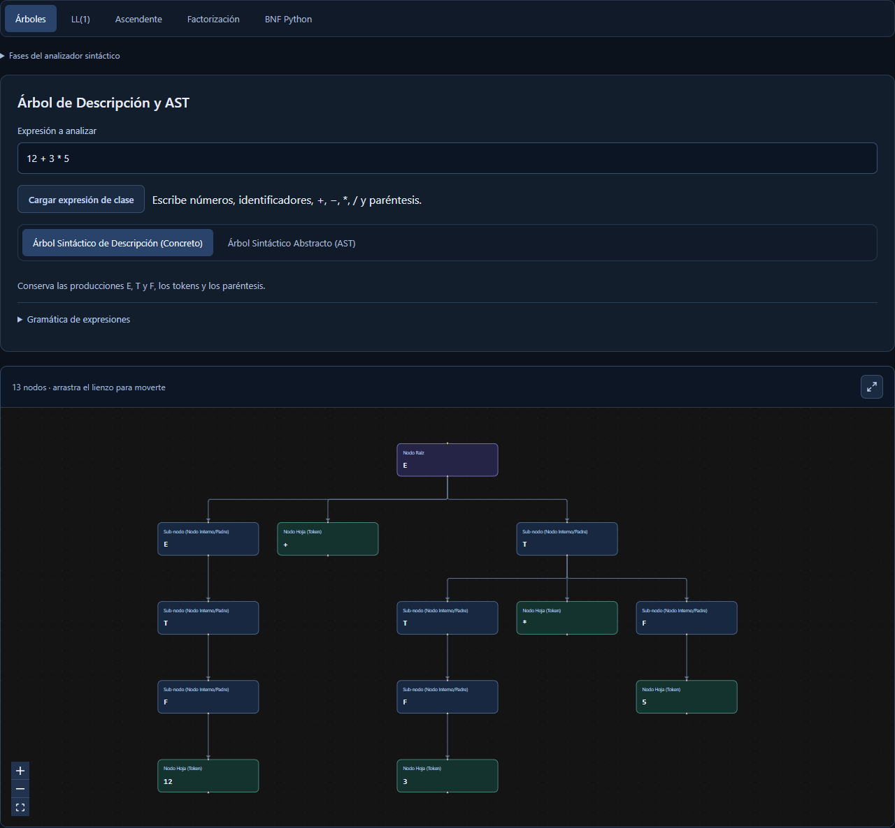
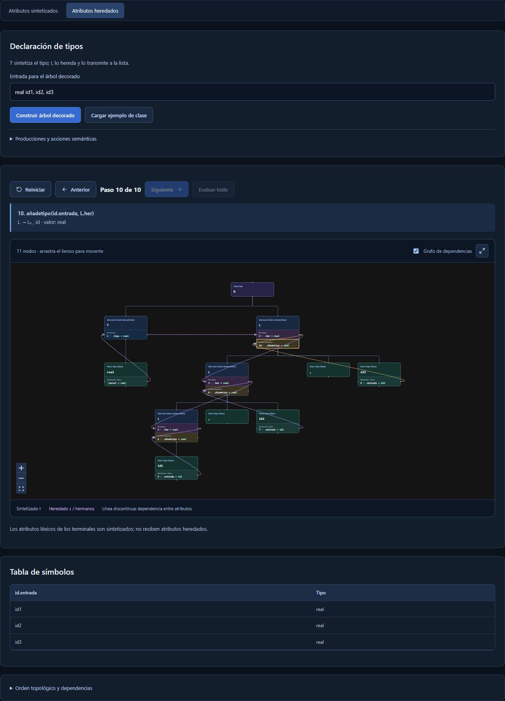

# SyntaxLab

An interactive study lab for formal languages and compiler design. SyntaxLab lets students edit grammars and inputs, inspect the structures their inputs produce, and follow parsing and attribute evaluation one step at a time.

## Why I built it

While studying Automata and Formal Languages in my Systems Engineering degree, I needed a more visual way to practice grammar transformations, parsing, and derivation trees. On paper, it was difficult to see where a production changed a derivation or why a parser rejected an input. I built SyntaxLab to turn those exercises into something I could change, replay, and inspect.

The main workspace opens directly to syntax trees and groups the course material into three modules. The interface is in Spanish. This guide uses the labels shown in the app so you can follow the examples.



## What you can explore

| Module | What it computes and displays |
| --- | --- |
| **Week 9 · Grammars** | Classifies production rules in the Chomsky hierarchy, detects direct and indirect left recursion and direct right recursion, and shows substitutions and new productions during left-recursion elimination. Includes ten editable class examples. |
| **Week 10 · Parsing and trees** | Builds a concrete syntax tree (CST) and an abstract syntax tree (AST) from an arithmetic expression. Calculates FIRST and FOLLOW sets, fills an LL(1) table, and traces the predictive stack. The SLR parser constructs LR(0) states and shows shift, reduce, accept, and error actions. Also includes left factoring and an editable BNF derivation exercise. |
| **Week 11 · Syntax-directed definitions** | Displays synthesized and inherited attributes on a decorated tree. Follow the dependency edges, step through attribute evaluation in topological order, and inspect the expression output or resulting symbol table. |

**Otros laboratorios** opens the secondary workspace. Its SQL lab shows tokens with source positions, lexical and syntax diagnostics, CSTs, ASTs, productions, and leftmost and rightmost derivations. An optional JSON catalog supplies tables, columns, and function signatures for type and name checks. The workspace also includes guided and free context-free derivations, regular expression to automaton conversion and simulation, and practice questions with feedback and local progress.

## Try it locally

Use **Node.js 22.12 or newer on a supported release line** and npm. The application runs entirely in the browser and requires no API keys, database, or environment file.

```sh
git clone https://github.com/marlonporres/syntaxlab.git
cd syntaxlab
npm ci
npm run dev
```

Open `http://127.0.0.1:5173/`. If the port is occupied, use `npm run dev -- --port 5180` and open the address printed by Vite.

### Compare an expression's CST and AST

1. Open **Semana 10 → Árboles**. The default expression is `12 + 3 * 5`.
2. In **Árbol Sintáctico de Descripción (Concreto)**, follow the grammar productions down to the operator and number tokens.
3. Switch to **Árbol Sintáctico Abstracto (AST)**. Addition is the root, with `12` on the left and multiplication of `3` and `5` on the right.
4. Replace the expression with `(12 + 3) * 5`. The AST now has multiplication at the root. Enter `12 +` to see the syntax error.

### Follow an attribute through the tree

Open **Semana 11 → Atributos heredados** with the input `real id1, id2, id3`. Select **Construir árbol decorado** and use **Siguiente** to follow the dependencies. After ten evaluation steps, the symbol table lists `id1`, `id2`, and `id3` with type `real`. In **Atributos sintetizados**, the default input `3 * 5 + 4 n` produces `19`.



## Architecture

SyntaxLab uses **React, TypeScript, Vite, and CSS**. React Flow renders the exam trees and attribute dependency graphs. The secondary SQL editor uses Monaco with locally bundled assets. Its tree explorer renders and exports SVG.

| Location | Responsibility |
| --- | --- |
| [`src/App.tsx`](src/App.tsx) and [`src/components/exam`](src/components/exam) | Exam navigation, editable examples, diagram controls, and step-by-step views. |
| [`src/engine/exam`](src/engine/exam) | TypeScript implementations for grammar classification and transformation, expression trees, SLR parsing, the BNF exercise, and attribute evaluation. |
| [`src/engine/formal.ts`](src/engine/formal.ts) and [`src/engine/grammar.ts`](src/engine/grammar.ts) | Reusable predictive parsing, automaton construction, simulation, and context-free derivation logic. |
| [`src/engine/sql`](src/engine/sql) | Lexer, recursive-descent parser, CST and AST projection, derivations, and catalog-based semantic checks. |
| [`src/LegacyWorkspace.tsx`](src/LegacyWorkspace.tsx) and [`src/lib/workspace.ts`](src/lib/workspace.ts) | Secondary labs and local draft and preference storage. |
| [`tests`](tests) and `src/**/*.test.ts` | Chromium interaction tests and Vitest tests of the engines and persistence. |

The engines return structured results to the UI. The SQL lexer preserves exact source ranges so a token, tree node, or diagnostic can highlight its text in Monaco. Lexical errors stop parsing, and catalog checks run separately once an AST exists. Editing the SQL draft hides results tied to the previous input until it is analyzed again.

## Computer science in practice

- **Formal grammars.** The classifier examines the productions you enter. Left-recursion elimination and left factoring expose the intermediate rules, including the new nonterminals.
- **Parsing.** Fixed-point FIRST and FOLLOW computation feeds both the LL(1) predictive table and the reductions in the SLR table. The stack traces make each parser's decision inspectable. Conflicting actions remain visible.
- **Trees and dependencies.** The CST retains grammar structure, while the AST makes precedence and grouping easier to see. Syntax-directed definitions connect attributes with a dependency graph and use a topological order to evaluate them.
- **Automata.** The secondary workspace uses Thompson construction, subset construction, and DFA minimization. It exposes the generated states and transitions and traces recognition of an input string.

## Design decisions and lessons

A chart alone does not explain a parse. The interface pairs diagrams with the grammar, stack, or attribute rule that produced them. Separating the TypeScript engines from the renderers made it possible to test those decisions independently of the browser.

The classroom examples also made error handling important. The supplied SLR example keeps `abcdef` as its input and correctly rejects it. The grammar derives `abcdabef` from `S`, so the lab offers that string as a separate comparison. SQL validation distinguishes grammar acceptance from catalog completeness for the same reason. Each result should mean exactly what the engine checked.

## Tests and build

```sh
npm test
npm run build
npx playwright install chromium
npm run test:e2e
```

`npm run test:release` runs unit tests, the build, and browser tests together. Playwright starts Vite on port `5176` and exercises desktop, tablet, and mobile Chromium viewport profiles. Set `SYNTAXLAB_TEST_PORT` if that port is occupied. The production build writes static files to `dist/`. Use `npm run preview` to inspect that build locally.

## Scope and possible extensions

- **Grammar analysis** uses the supplied production forms and bounded classroom algorithms. Chomsky classification describes those rules. Left-recursion elimination can report a remaining cycle or a transformation it cannot complete. The parsers report conflicts rather than selecting an arbitrary action.
- **SQL** recognizes one educational `SELECT` or `INSERT INTO … SELECT` with expressions, aliases, calls, and `CASE`. It does not execute queries. `FROM`, `WHERE`, `JOIN`, subqueries, DDL, and multiple statements are outside the supported dialect.
- **BNF and attributes** use specific teaching grammars. The Python exercise recognizes a small import, assignment, and print pattern without running Python or TensorFlow. Attribute evaluation covers the two provided expression and declaration grammars.
- **Data** stays in the browser. The secondary workspace stores drafts, catalog settings, and progress locally. The exam workspace retains inputs while switching weeks during the session.

Possible extensions include a larger tested SQL dialect, configurable attribute grammars, and more worked examples for parser conflicts and recovery.
